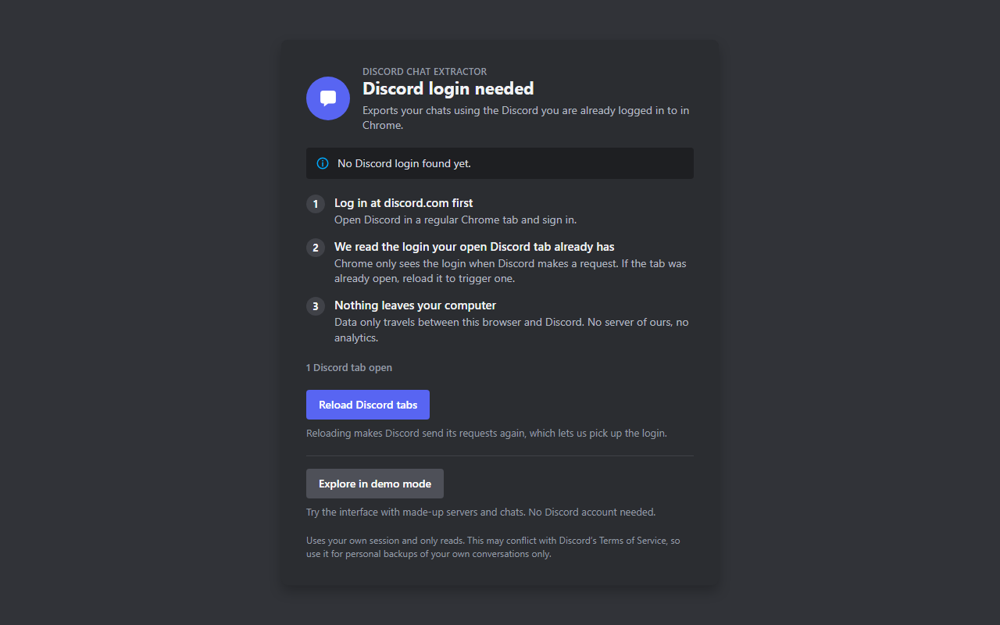
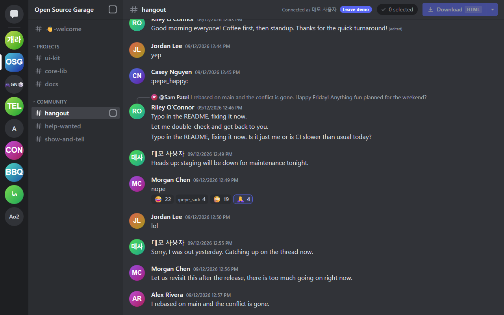
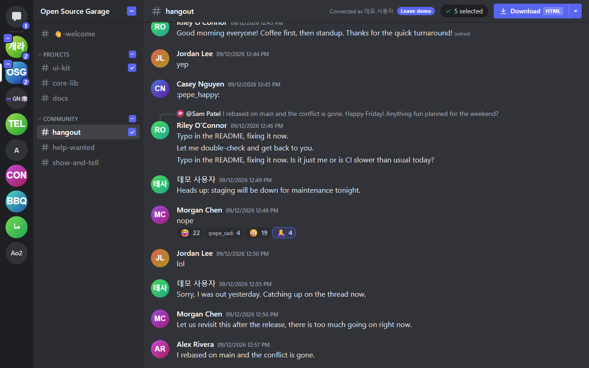
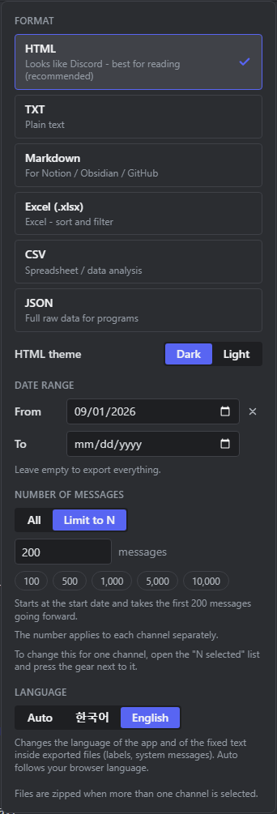
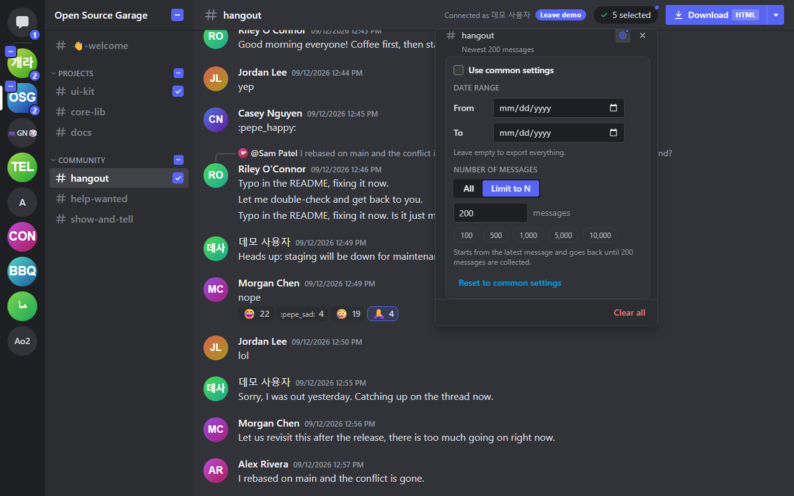
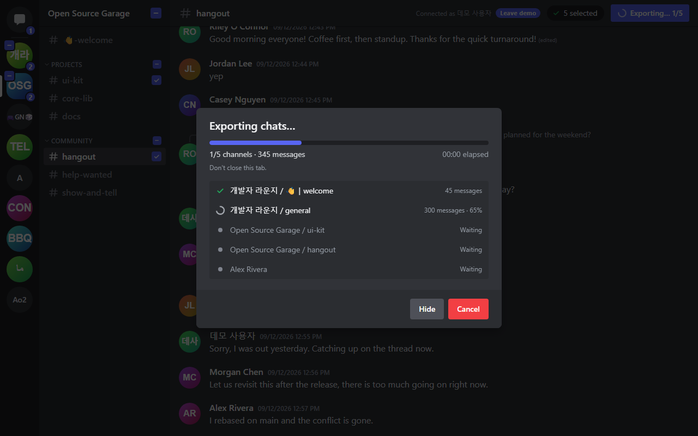
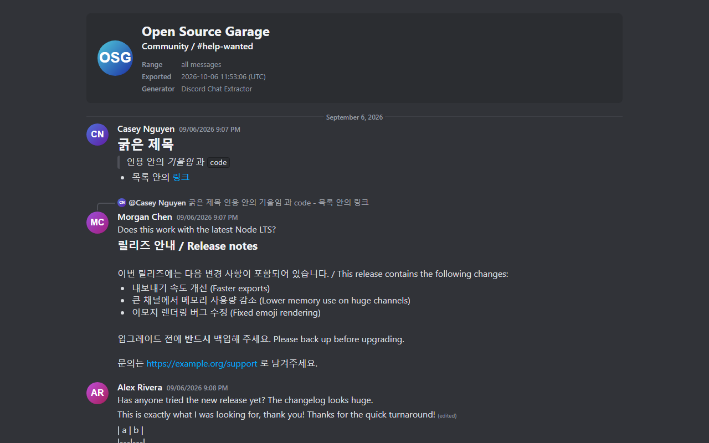

# Usage guide

Everything from installing [Discord Chat Extractor](../README.en.md) to having your chats in a file.
[한국어](USAGE.md) | **English**

> [!WARNING]
> The tool calls the Discord API directly with the **token of the account you are logged in with**. Discord does not allow this kind of use (self-bots), so your account can be penalised, and exported files contain **other people's messages**. Please read the [Disclaimer](../DISCLAIMER.md) and the [Terms of Use](../TERMS.md) before you use it. Every screen in this guide shows made-up **demo data**.

## Contents

- [Before you start](#before-you-start)
- [Install and update](#install-and-update)
- [First start and your login](#first-start-and-your-login)
- [Demo mode](#demo-mode)
- [A tour of the screen](#a-tour-of-the-screen)
- [Selecting what to export](#selecting-what-to-export)
- [Export options](#export-options)
- [Settings per channel](#settings-per-channel)
- [Downloading](#downloading)
- [The formats](#the-formats)
- [Large exports and tips](#large-exports-and-tips)
- [Using the keyboard](#using-the-keyboard)
- [Troubleshooting](#troubleshooting)
- [Privacy and security notes](#privacy-and-security-notes)
- [Uninstalling](#uninstalling)

## Before you start

**You need**

- Chrome 116 or newer
- A Discord account that is logged in to <https://discord.com/app> in that same Chrome (`ptb.discord.com` and `canary.discord.com` work too)

**What the tool does**

- It reads the messages of the servers, channels and DMs the logged-in account can see, and saves them to files.
- It only reads. It never sends, edits or deletes a message.

**What it does not do**

- It cannot export somebody else's account, or channels your account cannot see.
- It does not download attachment files. It only writes down their links.
- It does not show new messages as they arrive. The screen is a snapshot of when you opened it.

## Install and update

### Install from the release ZIP

1. Download `discord-chat-extractor-v<version>.zip` from the [latest release](https://github.com/LanturnHouse/discord-chat-extractor/releases/latest). The release also carries a SHA-256 checksum file (`.sha256`) for the ZIP. To check that your download is intact, run `Get-FileHash <the ZIP> -Algorithm SHA256` in PowerShell, or `shasum -a 256 <the ZIP>` on macOS or Linux, and compare the result with the value in the `.sha256` file.
2. Unzip it into a folder that is **going to stay there**. Chrome reads the extension's files straight from this folder, so do not delete or move it while you use the extension. If you move it, Chrome sees a new extension and the saved settings (format, theme, language) may go back to their defaults.
3. Open `chrome://extensions` in the address bar.
4. Turn on **Developer mode** at the top right.
5. Press **Load unpacked** and choose the folder that **directly** contains `manifest.json`. If you pick a folder one level above or below, Chrome reports that it cannot find the manifest file (`manifest.json`).
6. When Discord Chat Extractor shows up in the list you are done. To keep its icon visible, click the puzzle-piece icon in the toolbar and press the pin next to this extension.

### Build from source and install

You need Node.js 22.12 or newer and Git.

```bash
git clone https://github.com/LanturnHouse/discord-chat-extractor.git
cd discord-chat-extractor
npm ci
npm run build
```

In step 5 above choose the **`dist` folder** of this repository.

> [!TIP]
> In the Windows Command Prompt (cmd), to go to a folder on another drive you must use **`cd /d D:\project`**, not `cd D:\project`. See [Troubleshooting](#npm-run-build-says-missing-script-build).

### Update

- **Release ZIP**: unzip the new ZIP over the old folder, or into a new folder and repeat the steps above (then remove the old extension). If you overwrote the folder, press the reload (⟳) button on this extension's card in `chrome://extensions`.
- **Source**: run `git pull`, `npm ci` and `npm run build` in turn, then press the same reload button.

Reloading the extension can clear the login that is kept only in memory, so reload a Discord tab once so that it is read again ([next chapter](#first-start-and-your-login)). If the app tab was open, reload that too.

### Open the app

Click the **Discord Chat Extractor** icon in the toolbar and the app opens in a new tab (`chrome-extension://…/app.html`). If it is already open, Chrome switches to that tab instead of making a second one.

## First start and your login

The app never asks for your Discord username or password. Instead it reads the login (token) from **the requests your already-open Discord tab sends**.

1. Log in to Discord in the same Chrome.
2. Click the toolbar icon to open the app. If it has already read your login you go straight to the main screen.
3. If it has not, you see this help screen.



The button depends on what the app finds.

| State | Shown | What to do |
| --- | --- | --- |
| No Discord tab is open | "No Discord tab is open" + **Open Discord** | It opens Discord in a new tab. Log in, then come back to the app tab. |
| One or more Discord tabs | "N Discord tab(s) open" + **Reload Discord tabs** | Press it. |

**Reload Discord tabs** reloads every open Discord tab (`discord.com`, `ptb.discord.com`, `canary.discord.com`). A Chrome extension can only see a request's login **at the moment the Discord page sends it**, so a tab that was already open has to be reloaded to send its requests again. Give Discord a moment to load; "Login detected. Loading…" appears and the app moves on to the main screen by itself. The help screen counts the Discord tabs again every 3 seconds, and whenever you come back to the app tab, so it keeps up if you open Discord first.

The top line of the help screen tells you why you are there.

- "No Discord login found yet." — the first time, or after the browser was restarted.
- "Your Discord login has expired. Please log in again." — Discord invalidated the login while you were using the app.
- "Discord rejected the login. Please log in again in a Discord tab." — Discord did not accept what was read.

**Good to know**

- The login lives only in `chrome.storage.session` (memory only). Closing the browser or reloading the extension clears it. It is never written to disk, logs or exported files.
- While the app is open it keeps using the **first account** it checked, even if you log in to another account in another tab (so accounts cannot get mixed up halfway through a job). The "Connected as …" label at the top of the main screen tells you which account it is. To switch accounts, reload the app tab.
- If Discord rejects the login (401) while you work, the app goes back to the help screen and clears its data.

## Demo mode

A mode for trying the screen and the export without a Discord account. It contains made-up servers ("개발자 라운지", "Open Source Garage" and more), DMs and group DMs, and thousands of messages, and it **sends no network requests at all.** Selecting, options and export all work exactly as in the real mode, so it is a good place to look at each format or practise with the options.

- Press **Explore in demo mode** on the help screen.
- Or add `?mock=1` to the app's address (`chrome-extension://<extension id>/app.html?mock=1`). `http://localhost:5173/app.html?mock=1` from `npm run dev` shows the same screen without any extension.
- Inside the extension, the **Leave demo** button at the top takes you back to the real mode. In demo mode the tab title is "Discord Chat Extractor - Demo mode".

## A tour of the screen



**1. Server list (far left)**

- The speech-bubble icon at the top is your **Direct Messages**.
- Below it are your servers, in the order the Discord API returns them. The order and folders you set up in the Discord app are not available through the API, so they are not reflected.
- A server without an icon shows the first letters of its name.

**2. Channel list (second column)**

- When you open a server **for the first time**, its categories and channels are fetched (you briefly see a placeholder).
- Click a category name to fold or unfold it.
- You see text channels (#), announcement channels (megaphone), and voice and stage channels (their text chat).
- **Forum and media channels** have no messages, only posts. Click one to fold or unfold its list of posts, and click a post (an active thread) to open it. Threads shown indented under ordinary channels only appear in demo mode ([known limitations](../README.en.md#known-limitations)).
- A channel that your roles are computed not to allow is dimmed, has a padlock and no checkbox. Clicking it shows "You can't view this channel".

**3. Direct messages list**

- Type a name into **Find a conversation** to filter the list. Part of a name or username is enough. Clear it with the ✕ in the box, or with Esc.
- Group DMs show "N members" under their name.
- The list is what the Discord API returns as your DMs (see [My DMs are missing or only some show](#my-dms-are-missing-or-only-some-show)).

**4. The messages**

- Opening a channel loads its **newest 200 messages** (the API gives only 100 at a time, so that is two requests).
- When you scroll close to the top, **200 more** are loaded and added above. What you were looking at does not jump.
- At the start of the channel you see "This is the start of the #channel channel." and nothing more is requested.
- When you have scrolled up, the **Jump to latest** button at the bottom right takes you back to the newest message.
- This view is **for checking**. The export covers the whole history of the channel (or the range you set in the options), not just what is loaded on screen.

**5. The top bar**

- Left: the open channel's name and topic (the topic is cut to one line).
- Right: "Connected as …" → the **N selected** chip → the **Download** split button.

There is no message box, search, profile, pins, member list, notification badges, server folders, settings or voice connection. They were left out **on purpose** ([design decisions](DECISIONS.md)).

The layout works from a window width of 900 px. Below that the page scrolls sideways.

## Selecting what to export



**Clicking views, the checkbox selects for export.** As in Discord, clicking a row opens that channel to read; you decide separately, with the checkbox, whether it is exported.

| What you want to select | Where its checkbox is |
| --- | --- |
| A channel, thread, forum post or DM | The right end of its row |
| A whole category | The right end of the category name's line |
| A whole server | The top-left corner of the server's icon, or next to the server name at the top of the channel list |
| All DMs that are shown | The right end of the "Direct Messages" title line (only the matches while you are searching) |

- Checkboxes appear when you hover or move to them with the keyboard, and **selected ones are always visible.**
- Ticking a **server or category** selects every channel and thread in it that can be selected. Ticking a server fetches its channel list first. Channels you have no access to, and forum and media channels themselves (they have no messages), are left out.
- A partly selected category or server shows a **− (dash)** instead of a check. Pressing it then selects **everything**, and pressing a fully selected box clears it.
- The number badge at the bottom right of a server icon is how many items are selected in that server; on the DM icon it is the number of selected DMs.
- **The selection survives switching servers and DMs**, so you can export things picked from several servers at once. It only lives in memory, though: reloading or closing the app tab clears it.

### Checking the selection

The **N selected** chip at the top opens a list of what you picked, grouped by server (DMs under "Direct Messages"). The **✕** on a row removes that one, **Clear all** at the bottom removes everything. The gear on a row is the [settings per channel](#settings-per-channel). While nothing is selected the chip looks dimmed and does not open.

## Export options

The **▾** to the right of the **Download** button (its accessible name is "Export options") opens the options window. If nothing is selected you get the "Select channels first" hint instead.



### Format

Choose one of six. The format you pick is remembered for next time and shown as a small tag on the **Download** button (HTML, TXT, MD, XLSX, CSV, JSON). What each result looks like is described [below](#the-formats).

The **HTML theme** (Dark/Light) only appears when the format is HTML, and it is remembered too.

### Date range

- Pick a **From** date and a **To** date. Leave both empty ("Leave empty to export everything.") for the whole channel.
- A date means the **whole day in your computer's (browser's) time zone.** The start date counts from 00:00:00 of that day and the end date up to 23:59:59 of that day, inclusive. Picking the same day for both gives exactly that day.
- A start date after the end date shows "The start date is later than the end date."; an unfinished date shows "Enter a valid date." The **✕** at the right of an input clears the date.

### Number of messages

- **All** (the default) has no limit.
- **Limit to N** takes a number from 1 to 100,000. There are quick picks for 100, 500, 1,000, 5,000 and 10,000.
- The number applies **to each channel**. With 3 channels and 200 you get 200 from every channel.
- A decimal, an empty value or a number out of range is refused with "Use a whole number, without decimals.", "Enter the number of messages." or "Enter a number from 1 to 100,000."

**How dates and a number work together**

A sentence under the number input says what the current setting means. The rules are:

| From | To | Number | Which messages |
| --- | --- | --- | --- |
| none | none | N | **The newest N**, counting back from the latest message |
| set | none | N | **N messages from the start date**, going forward (oldest toward newest) |
| set | set | N | N messages from the start date, **never beyond the end date**. If the period holds fewer than N you get what is there. |
| none | set | N | **The newest N up to the end date** |
| any | any | All | Everything in that period without a limit (the whole channel if both dates are empty) |

For example, a start date of 2026-09-01 and 200 gives the **first** 200 messages after September 1; 200 without dates gives the **newest** 200. Either way the file lists **older messages first, newest last.** The "Range" line in the file's header says which range was applied (for example "newest 200 messages").

"Newest N" keeps the N messages in memory until it can write them, which is why the number is capped at 100,000. If you need more, use **All**: it appends each page to the file as it arrives, so it has no such cap.

### Language

**Auto** (follows the browser language), **한국어**, **English**. It changes the language of the app and of the **fixed text inside exported files** (labels, system messages and so on). Message text itself is never translated. With Auto, a Korean or unknown browser language starts in Korean, any other language in English.

### What is remembered

The format, the HTML theme and the language are saved in the browser and stay for next time (`chrome.storage.local`). **The date range, the number of messages and the selection are not saved**; reloading the app tab brings them back to their defaults.

### When a value is wrong

If you press **Download** while a date or number is not valid, the export does not start. The options window (or the channel's own settings) opens at the problem instead.

## Settings per channel

For exporting several channels where one needs a different range. For example the newest 200 for one channel and everything for the rest.



1. Press **N selected** to open the selection list.
2. Press the **gear** on the channel's row (accessible name "Export settings for …"). A settings panel unfolds under the row. Only one panel is open at a time.
3. Untick **Use common settings**; it starts as a copy of the current common values. Change the date range and the number of messages for this channel only. While it uses the common settings the panel shows "Common settings: …" with what they are now.
4. To undo, press **Reset to common settings** or tick **Use common settings** again.

Good to know:

- Only the **date range and the number of messages** can be set per channel. The format, HTML theme and language are the same for every channel (a ZIP with mixed formats would be confusing).
- A row with its own settings shows a summary under its name ("Newest 200 messages" and so on) and its gear is lit. The **N selected** chip gets a small dot, and the options window says "N channels use their own settings, so the date range and number above do not apply to them."
- If a channel's own settings cannot be exported, its row says "Check these settings" in red, and **Download** does not start but opens that channel's settings.
- Own settings are not saved, and **disappear when the channel is deselected.** A channel's own settings replace the common ones as a whole (both dates and the number).

How to read the summaries: "All messages", "Newest 200 messages", "From 2026-09-01", "From 2026-09-01: first 200", "Until 2026-09-30", "Until 2026-09-30: newest 200", "2026-09-01 – 2026-09-30", "2026-09-01 – 2026-09-30: first 200".

## Downloading

When you have selected and set your options, press **Download** at the top. The main part **starts right away with the format you used last**; the ▾ opens the options. With nothing selected you only get the "Select channels first" hint and nothing starts.

### The progress window



- The bar and "1/5 channels · 345 messages" and "00:04 elapsed" at the top show the overall progress. "Don't close this tab." sits below them.
- The state of each channel: a check = done ("45 messages"), a spinner = in progress ("300 messages · 65%"), "Waiting", "No access" (padlock), "Error", "Cancelled". A channel with different own settings shows its summary on the row.
- The percentage is an **estimate.** With a number it is based on that number; otherwise on the time between when the channel was created (or your start date) and now, so it can be off. It never reads 100% before the channel is done.
- Channels are processed **one at a time, from the top**, and messages are fetched from the oldest in batches of 100.
- The order is the order you see on screen, not the order you ticked: for each server in the server list its channels without a category and then those in category order, and the DMs last.

**Hide** closes the window but the export goes on. The **Download** button then reads "Exporting… 2/5" and pressing it brings the window back.

### Cancelling

**Cancel** goes through "Cancelling…" to "Export cancelled".

- **Cancelling saves nothing by itself.** If some channels were already finished it says "N channels were finished before you cancelled. They have not been saved yet. Closing without saving discards them." and the **Save the N completed channels** button saves them. If none were finished there is nothing to save.
- While several files are being put into a ZIP, Cancel is off with "The ZIP is already being created and can no longer be cancelled." That is local work and ends quickly.

### When it is done

"Export complete" comes with a summary such as "5 channels, 3,200 messages saved as ….zip". The file is saved through the **browser's normal download**, so it lands in Chrome's download folder (or asks where, depending on your Chrome settings).

- **Skipped, no access: N**: channels you may not read (403) or that were deleted (404), listed with the reason.
- **Failed: N**: channels dropped for any other reason: a network error, a Discord server error, a ZIP limit and so on.
- "The export stopped early, so N more channels were not exported." means Discord asked for a very long wait (more than 60 seconds) and the export stopped. The channels finished by then are saved.
- If no channel could be exported you see "None of the selected channels could be exported." and no file is made.
- Close the window with **Close** or Esc (Esc only works once it has finished).

### The saved file

| Situation | File |
| --- | --- |
| One channel finished | The file itself, named `Server name - channel name.ext` (a DM is `name.ext`, a thread or forum post is `Server name - parent channel - thread name.ext`) |
| Two or more channels finished | One ZIP named `Discord Export 2026-10-06.zip` (today's date on your computer) |

The folders inside the ZIP:

```
Discord Export 2026-10-06.zip
├─ Open Source Garage/             server name
│  ├─ Projects/                    category name (a channel without a category sits right under the server folder)
│  │  ├─ ui-kit.html
│  │  └─ core-lib.html
│  └─ welcome.html
├─ Another Server/
│  └─ Announcements/
│     └─ news.html
└─ Direct Messages/                DMs and group DMs
   └─ Alex Rivera.html
```

- In file and folder names, characters Windows does not allow (`\ / : * ? " < > |`) and control characters become `_`, reserved names such as `CON` or `NUL` get a `_`, trailing dots and spaces are removed, and a single name is cut at 80 characters (UTF-16 units).
- If two names clash in one folder (even only by upper/lower case) the file name gets `[channel ID]` appended. A file and a folder that would share a name are also kept apart.
- Even if you selected several channels, when **only one** finishes you get that one file instead of a ZIP.

### If your login expires

If Discord rejects the login (401) in the middle of an export, the app stops, **automatically saves the channels finished so far** (a file appears in your download folder) and goes back to the login help screen. That screen does not show the export result, so check what was saved from the file you received (the folder layout inside the ZIP). Log in again and export just the rest.

### If saving fails

If "Could not save the file" appears, the finished work is still in memory. Press **Save the N completed channels** to try again. Closing the window or the tab loses it.

### If you close the tab during an export

If an export is running, or has finished with results you have not saved yet, closing or reloading the tab makes the browser ask whether you really want to leave the page. Leaving loses the export and its results.

## The formats

| Format | Extension | Open it with | In one line |
| --- | --- | --- | --- |
| HTML | `.html` | Any browser | Reads like Discord |
| TXT | `.txt` | Notepad or any editor | A simple text log |
| Markdown | `.md` | Notion, Obsidian, GitHub, VS Code | A formatted document |
| Excel | `.xlsx` | Excel, Google Sheets, LibreOffice | A table; sort and filter |
| CSV | `.csv` | Excel (use the import), scripts, databases | Table data |
| JSON | `.json` | Programs, any text editor | All the raw data |

Every format is **UTF-8**, and times are written in **your browser's time zone** as `YYYY-MM-DD HH:mm:ss` (JSON is the exception, it uses UTC `…Z`). Fixed text such as headers and labels follows the [language setting](#language). The examples below use the made-up data of demo mode.

### HTML



- One file, **no script**, and a strict CSP inside. Nothing in a message can run as code in the file.
- The top shows the server, channel, topic, range and the time of export, and the bottom the number of messages and the times of the first and last message.
- It looks like the app (mentions, replies, reactions, embeds, stickers, polls, system messages), in **dark or light** as you choose in the options. Messages by the same person within 7 minutes are grouped.
- Images and attachments are **links to Discord's servers.** You need an internet connection and the links must still be valid. A note at the bottom of the file says they can expire.

### TXT

```text
================================================================
Server: Open Source Garage
Channel: Community / #help-wanted
Range: all messages
Exported: 2026-10-06 11:45:11 (UTC)
Generator: Discord Chat Extractor
================================================================

[2026-09-06 21:07:57] Morgan Chen
> ↪ Replying to Casey Nguyen: …
Does this work with the latest Node LTS?

[2026-09-06 21:08:47] Alex Rivera
Has anyone tried the new release yet? The changelog looks huge.
```

Every message starts with `[time] name`, and attachments, embeds, stickers, polls, reactions and so on follow as parts with a title in braces, such as `{Attachments}`. A reply starts with `> ↪`. A line inside a message that imitates the structure (a `[2026-…` header, `===` and the like) gets a `\` in front so it cannot be mistaken for the real structure.

### Markdown

```markdown
# Open Source Garage - #help-wanted

- **Server:** Open Source Garage
- **Channel:** Community / #help-wanted
- **Range:** all messages

---

## 2026-09-06

**Casey Nguyen** <sub>21:07:12</sub>

> ↪ Replying to **Casey Nguyen**: …
```

Each day gets a `##` heading and each message a bold name with a small time. Embeds, polls and forwarded messages are block quotes. Raw HTML in messages and text that imitates headings, quotes or lists is escaped, and a link whose text looks like a different address (`[https://good](https://evil)`) gets the real domain added. Only pictures from Discord's image servers are shown inline; everything else is a link.

### Excel (.xlsx)

- One channel is one file (one workbook). The sheet is named after the channel (up to 31 characters, `[ ] : * ? / \` become `_`), and if the rows pass Excel's limit (1,048,576) the sheet continues as `name (2)`.
- The first row is the header, **frozen**, with a **filter** switched on, so you can sort and search right away. Column widths are set.
- **Every cell is text.** A message starting with `=` is never run as a formula, and the 18 to 19 digit IDs stay exact.
- It is built with the whole channel in memory, so beyond a few hundred thousand messages it gets slow or heavy. Use CSV or JSON then.

### CSV

The columns are the same as in XLSX. One line is one message.

| Column | Contents |
| --- | --- |
| Message ID / Author ID | Discord's unique numbers (18 to 19 digits) |
| Timestamp / Edited | When it was sent, when it was edited (empty if never) |
| Author | The display name |
| Bot | `Y` if a bot wrote it |
| Content | The message text (system messages are written out as a sentence; it can span lines) |
| Attachments | Links, one per line |
| Embeds | A one-line summary per embed |
| Stickers / Reactions | Names / in the form `😀 3; 👍 5` |
| Reply To | The ID of the message it replies to |
| Type | `message`, `reply`, `forward`, `system`, otherwise `type-number` |

- It starts with a UTF-8 BOM so Excel shows Korean and other non-ASCII text correctly.
- A cell starting with `=`, `+`, `-` or `@` gets a `'` in front so it never runs as a formula.
- **Opened in Excel**, the 18 to 19 digit IDs show as `1.42E+18`, and **saving from Excel can destroy the last digits for good.** If you will use Excel, choose the **Excel (.xlsx)** format, or open the CSV with "Data > From Text/CSV" and set the ID columns to **Text**. Other programs (Python pandas, databases and so on) read the numbers exactly.

### JSON

```json
{
  "exportedAt": "2026-10-06T11:45:25.632Z",
  "generator": "Discord Chat Extractor",
  "channel": { "id": "…", "name": "help-wanted", "kind": "text", "guild": { "id": "…", "name": "Open Source Garage" }, "category": "Community", "topic": null },
  "range": { "after": null, "before": null, "limit": null },
  "messages": [
    {"id":"…","channel_id":"…","author":{…},"content":"…","timestamp":"2026-09-06T21:07:12.000Z", …}
  ],
  "messageCount": 60,
  "firstMessageAt": "2026-09-06T21:07:12.002Z",
  "lastMessageAt": "2026-09-18T21:07:12.000Z"
}
```

- Each entry of `messages` is **the message object exactly as the Discord API returned it**, one per line, so line-based tools handle it well. Older messages come first.
- Times are UTC (ISO 8601), and the count is at the end of the file (`messageCount`).
- `after` and `before` in `range` are the date range that was applied, `limit` is the number of messages.

## Large exports and tips

- **Keep the app tab open while it exports.** Closing or reloading it stops the export and loses the result. You may look at other tabs, but keep the computer from going to sleep.
- Speed is decided by the **number of requests.** Discord returns 100 messages at most per request, so 10,000 messages need 100 requests and 100,000 need 1,000 or more. Requests are sent one after another.
- When Discord says "wait a moment" (a rate limit) the app waits for the time it names and carries on. If the wait is **longer than 60 seconds** it stops, saves the channels finished by then and does not keep knocking. Export the remaining channels a few minutes later.
- For a big channel, do a **trial** first with a number such as 100 to see what the result looks like.
- If you only need the recent part, a **number of messages** or a **date range** is the fastest way.
- Do not pick too many channels at once. A ZIP can hold about 3.75 GB / 65,535 files; a channel that no longer fits is listed as "Failed" and the rest is saved. Split the channels over several exports.
- The result of each channel collects in the browser's memory (a Blob, which the browser may keep on disk) until the end. **XLSX** is built with the whole channel in memory, and **"newest N"** only starts writing once the N messages have been collected. For channels with hundreds of thousands of messages, export **All** as CSV or JSON.
- If the computer slows down, close other heavy tabs and reduce the number of channels.

## Using the keyboard

Everything can be done without a mouse.

- The first **Tab** presses bring up three **skip links** at the top of the screen: "Skip to channel list", "Skip to messages", "Skip to export controls". Enter jumps to the channel list, the message list and the Download button. They exist because the server and DM lists can be hundreds of rows long.
- **↑ ↓ Home End** move between the icons of the server list and between the rows of the channel and DM lists (also when you are on a row's checkbox). **↓** in the "Find a conversation" box goes to the first row.
- **Enter / Space** open a row to read it, or tick and untick a checkbox.
- **Esc** closes an open options window, selection list or notice (focus returns to the button that opened it). In the selection list it first closes an unfolded channel panel. When the "Find a conversation" box has text, Esc clears it. The progress window can only be closed with Esc once it has finished.
- The format, theme, language and count choices in the options form one group. Tab into the group, then change the choice with **← → ↑ ↓ Home End**.
- While a window is open, Tab only cycles inside it.

## Troubleshooting

### My login is not detected

1. Check that you are **logged in** to Discord in the same Chrome (not looking at the login page).
2. On the app's help screen press **Reload Discord tabs** (or **Open Discord** if there is no tab) and wait until Discord has loaded completely. It moves on by itself within a few seconds.
3. If it does not, click a server or a DM in the Discord tab once so that Discord sends a request.
4. Open Discord in a normal window of the **same Chrome profile** the extension is installed in. Discord in another profile or in an incognito window may not be readable.
5. The address has to be `discord.com`, `ptb.discord.com` or `canary.discord.com`, and it has to be the **web** version, not the desktop Discord program.
6. If it still fails, check in `chrome://extensions` that the extension is on, reload it, and repeat steps 3 and 4.

### "Your Discord login has expired" / "Discord rejected the login"

You logged out of Discord, or Discord invalidated the login. Log in again in the Discord tab and press **Reload Discord tabs**.

### "Could not load your Discord data"

The first lists (servers, DMs) could not be fetched because of a network error, a rate limit or a Discord server error. Check your connection and press **Try again**.

### A channel says "You can't view this channel"

Your account may not read it. Such channels cannot be exported (no checkbox, and ticking a whole server leaves them out). Permissions are **estimated** from roles and channel settings, so a channel that looks open but that Discord refuses only turns locked after you first open it. If you hit one during an export it is listed as "Skipped, no access".

Conversely, when Discord or Cloudflare blocks you **temporarily** (a 403 that is not about permissions), the channel is not marked as locked; you see "Couldn't load the messages" and a **Try again** button. Try again a little later.

### The export is slow, or seems to hang

It may be a rate limit; the app waits for as long as Discord asks. If the progress window is open and the time keeps running, that is normal. If Discord asks for more than 60 seconds the app stops and saves the channels finished by then, with "Discord asked us to wait N min - try again later." Export the remaining channels after that time. After a rate limit do not repeat the export straight away; wait a while first.

### My DMs are missing or only some show

The app shows the conversations the Discord API returns as your DM list. A conversation you hid or closed in Discord may not be in it, and opening it again in Discord can make it appear. You may also be connected to the wrong account, so check that the "Connected as …" label at the top is the one you expect. A DM that is in the list but shows "You can't view this channel" when opened is one Discord refuses to let you read; it gets a padlock and cannot be selected.

### I can't see threads

Because of what a user token can do, only the **active posts of forum and media channels (at most 100 per channel)** can be found. Threads under ordinary text or announcement channels, and archived threads, cannot be listed.

### Pictures or attachments do not show

Attachments are not stored in the file, only linked to Discord. The links can expire after a while, and they do not show when you are offline or cannot reach Discord. Download any attachment you want to keep separately.

### Excel shows IDs as `1.42E+18`

That is what happens when Excel opens a CSV. See the [CSV section](#csv). Exporting as **Excel (.xlsx)** instead is the easiest fix.

### `npm run build` says "Missing script: build"

In the Windows Command Prompt (cmd), `cd D:\project` to a folder on **another drive** does not change the current drive. So you are still in `C:\Users\…` when you run `npm run build`. This project's `package.json` is not there, so npm looks for the script in the wrong place and answers "Missing script: build" (or that it cannot read a `package.json`).

- cmd: `cd /d D:\project\discord-chat-extractor` (`/d` changes the drive too), or type `D:` first and then `cd`.
- PowerShell changes the drive with just `cd D:\project`.
- To check where you are, run `dir package.json` (cmd) or `ls package.json` and see if the file is listed.

### The app is blank, or says "Something went wrong while showing this screen"

Press **Reload page**. If it continues, reload the extension in `chrome://extensions`, and if that does not help please open an [issue](https://github.com/LanturnHouse/discord-chat-extractor/issues). **Never put a token or real chat content in an issue** ([Security Policy](../SECURITY.md)).

### Clicking the toolbar icon opens no new tab

If the app tab is already open, that tab comes to the front instead of a new one opening. Look for the "Discord Chat Extractor" tab in your tab list.

### Korean (or other) text looks garbled

Every file is UTF-8. Only a CSV opened in Excel can show garbled text, and this tool's CSV has a BOM so it normally works. If it does not, choose **UTF-8** as the file origin in "Data > From Text/CSV". Open TXT and Markdown files in an editor that reads UTF-8.

## Privacy and security notes

- The login (token) is as powerful as a password. **Never post it in a screenshot, an issue or a chat.** The tool never shows the token on screen or writes it to a file.
- The app sends requests to nothing but the `discord.com` API. Pictures are loaded from Discord's image servers. When you open an exported HTML file later, your browser asks Discord's image servers for the pictures it links to.
- **Exported files contain other people's messages.** Decide carefully where you keep them and whether you share them. Keep exported files outside any code repository so they cannot be committed by accident.
- More: [Privacy Policy](../PRIVACY.md) · [Security Policy](../SECURITY.md) · [Disclaimer](../DISCLAIMER.md)

## Uninstalling

1. In `chrome://extensions` press **Remove** on the Discord Chat Extractor card. The login that is in memory and the saved settings (format, theme, language) go with it.
2. Delete the folder you unzipped the release into (or the `dist` folder) yourself.
3. Exported files stay in your download folder. Delete them if you no longer need them.
4. If you suspect your token was exposed, follow the instructions in the [Security Policy](../SECURITY.md).
