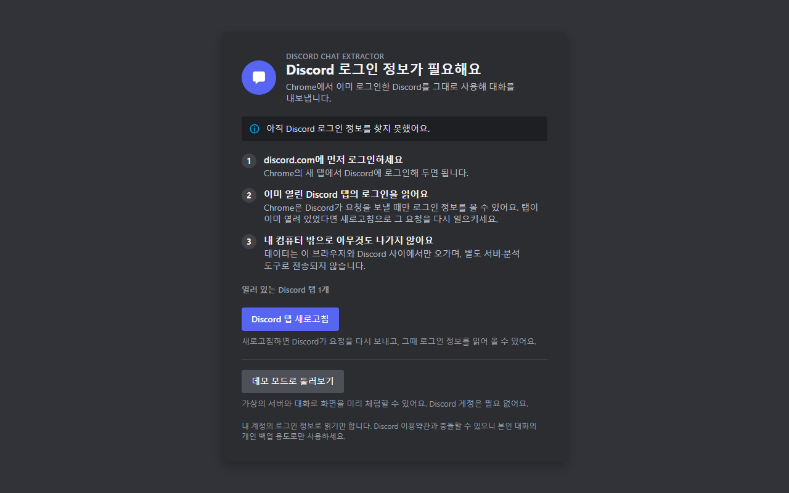
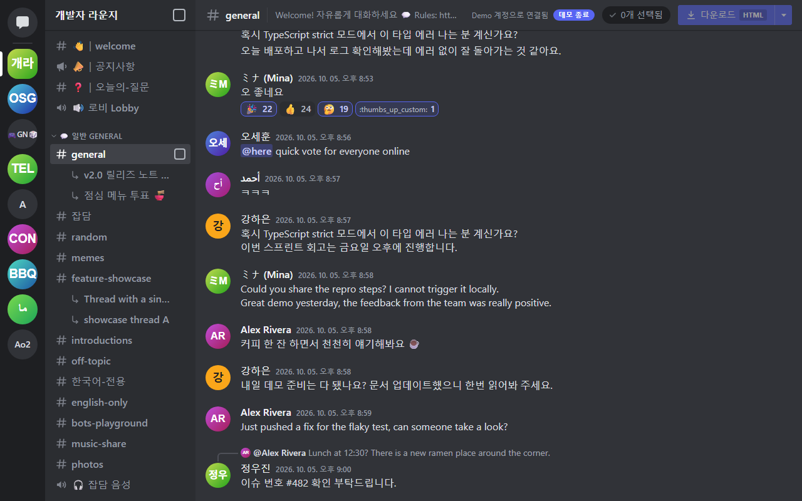
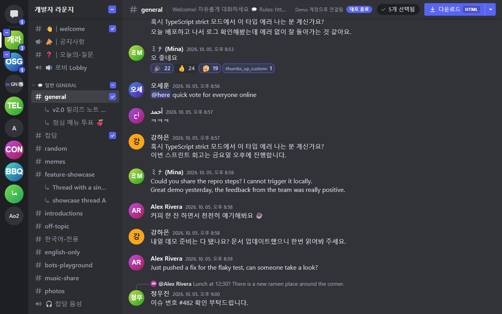
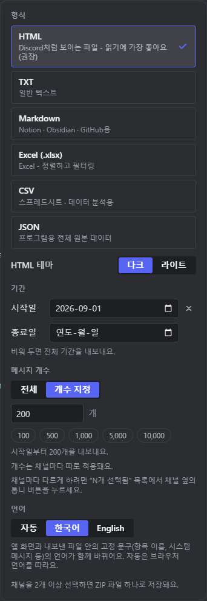
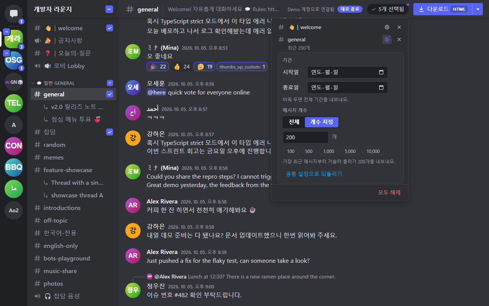
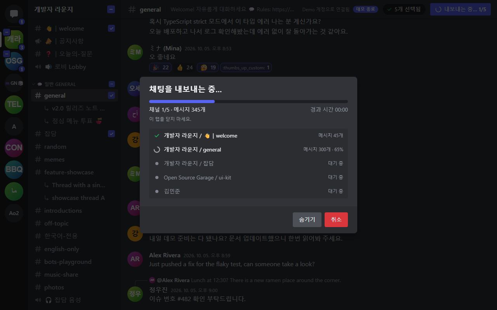
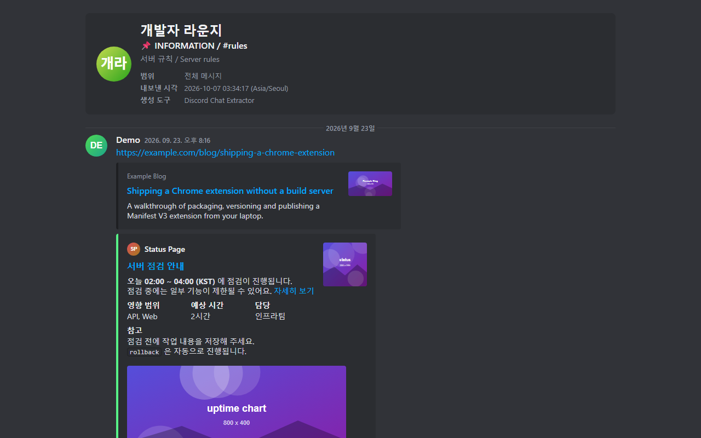

# 사용 가이드

[Discord Chat Extractor](../README.md)를 설치해서 대화를 내보내기까지의 모든 과정을 설명합니다.
**한국어** | [English](USAGE.en.md)

> [!WARNING]
> 이 도구는 로그인한 **본인 계정의 토큰**으로 Discord API를 직접 호출합니다. Discord는 이런 사용(셀프봇)을 허용하지 않으므로 계정이 제재받을 수 있고, 내보낸 파일에는 **다른 사람의 메시지**가 들어 있습니다. 쓰기 전에 [면책조항](../DISCLAIMER.md)과 [이용약관](../TERMS.md)을 읽어 주세요. 이 문서의 화면은 모두 데모 모드의 **가상 데이터**입니다.

## 목차

- [시작하기 전에](#시작하기-전에)
- [설치와 업데이트](#설치와-업데이트)
- [처음 실행과 로그인 정보](#처음-실행과-로그인-정보)
- [데모 모드](#데모-모드)
- [화면 둘러보기](#화면-둘러보기)
- [항목 선택하기](#항목-선택하기)
- [내보내기 옵션](#내보내기-옵션)
- [채널별 설정](#채널별-설정)
- [다운로드하기](#다운로드하기)
- [형식별 결과물](#형식별-결과물)
- [큰 내보내기와 팁](#큰-내보내기와-팁)
- [키보드로 쓰기](#키보드로-쓰기)
- [문제 해결](#문제-해결)
- [개인정보와 보안 메모](#개인정보와-보안-메모)
- [제거하기](#제거하기)

## 시작하기 전에

**필요한 것**

- Chrome 116 이상
- 같은 크롬에서 <https://discord.com/app>에 로그인한 Discord 계정 (`ptb.discord.com`, `canary.discord.com`도 됩니다)

**이 도구가 하는 일**

- 로그인한 계정이 볼 수 있는 서버, 채널, DM의 메시지를 읽어서 파일로 저장합니다.
- 읽기만 합니다. 메시지를 보내거나 고치거나 지우지 않습니다.

**하지 않는 일**

- 다른 사람의 계정이나, 본인 계정이 볼 수 없는 채널을 내보내지 못합니다.
- 첨부파일 자체는 내려받지 않습니다. 링크만 기록합니다.
- 새 메시지를 실시간으로 반영하지 않습니다. 화면은 연 시점의 스냅샷입니다.

## 설치와 업데이트

### 릴리스 ZIP으로 설치

1. [최신 릴리스](https://github.com/LanturnHouse/discord-chat-extractor/releases/latest)에서 `discord-chat-extractor-v<버전>.zip`을 내려받습니다. 릴리스에는 ZIP의 SHA-256 체크섬 파일(`.sha256`)도 함께 올라와 있습니다. 파일이 온전한지 확인하려면 PowerShell에서 `Get-FileHash <ZIP 파일> -Algorithm SHA256`, macOS·Linux에서 `shasum -a 256 <ZIP 파일>`을 실행해 `.sha256` 파일의 값과 비교하세요.
2. 압축을 풀어 **계속 둘 폴더**에 놓습니다. Chrome은 이 폴더의 파일을 직접 읽으므로, 확장 프로그램을 쓰는 동안 지우거나 옮기지 마세요. 폴더를 옮기면 Chrome이 새 확장 프로그램으로 보고 저장된 설정(형식·테마·언어)이 처음 상태로 돌아갈 수 있습니다.
3. 크롬 주소창에 `chrome://extensions`를 입력해 엽니다.
4. 오른쪽 위의 **개발자 모드**를 켭니다.
5. **압축해제된 확장 프로그램을 로드합니다**를 누르고, `manifest.json`이 **바로** 들어 있는 폴더를 고릅니다. 한 단계 위나 아래 폴더를 고르면 매니페스트 파일(`manifest.json`)을 찾지 못했다는 오류가 납니다.
6. 목록에 Discord Chat Extractor가 나타나면 끝입니다. 툴바의 퍼즐 조각 아이콘을 눌러 이 확장 프로그램 옆의 핀을 눌러 두면 아이콘이 항상 보입니다.

### 소스에서 빌드해 설치

Node.js 22.12 이상과 Git이 필요합니다.

```bash
git clone https://github.com/LanturnHouse/discord-chat-extractor.git
cd discord-chat-extractor
npm ci
npm run build
```

위 5단계에서 이 저장소의 **`dist` 폴더**를 고르면 됩니다.

> [!TIP]
> Windows의 명령 프롬프트(cmd)에서 다른 드라이브의 폴더로 가려면 `cd D:\프로젝트`가 아니라 **`cd /d D:\프로젝트`**를 써야 합니다. 자세한 내용은 [문제 해결](#npm-run-build가-missing-script-build라고-해요)을 보세요.

### 업데이트

- **릴리스 ZIP**: 새 ZIP을 풀어서 기존 폴더에 덮어쓰거나, 새 폴더를 만들어 위 설치 과정을 다시 합니다(이 경우 이전 확장 프로그램은 삭제하세요). 덮어썼다면 `chrome://extensions`에서 이 확장 프로그램 카드의 새로고침(⟳) 버튼을 누르세요.
- **소스**: `git pull`, `npm ci`, `npm run build`를 차례로 실행한 뒤 같은 새로고침 버튼을 누릅니다.

확장 프로그램을 새로고침하면 메모리에만 있던 로그인 정보가 지워질 수 있으므로, Discord 탭을 한 번 새로고침해서 다시 읽게 해야 합니다([다음 장](#처음-실행과-로그인-정보)). 앱 탭이 열려 있었다면 그 탭도 새로고침하세요.

### 앱 열기

툴바의 **Discord Chat Extractor** 아이콘을 누르면 앱이 새 탭으로 열립니다(`chrome-extension://…/app.html`). 이미 열려 있으면 새 탭을 만들지 않고 그 탭으로 이동합니다.

## 처음 실행과 로그인 정보

앱은 Discord 계정의 사용자 이름이나 비밀번호를 묻지 않습니다. 대신 **이미 열려 있는 Discord 탭이 보내는 요청**에서 로그인 정보(토큰)를 읽습니다.

1. 같은 크롬에서 Discord에 로그인해 둡니다.
2. 툴바 아이콘을 누르면 앱이 열립니다. 로그인 정보를 이미 읽었다면 곧바로 메인 화면이 나옵니다.
3. 아직 못 읽었다면 아래와 같은 안내 화면이 나옵니다.



안내 화면의 버튼은 상황에 따라 바뀝니다.

| 상태 | 표시 | 할 일 |
| --- | --- | --- |
| 열려 있는 Discord 탭이 없음 | "열려 있는 Discord 탭이 없어요" + **Discord 열기** | 누르면 Discord가 새 탭으로 열립니다. 로그인한 뒤 앱 탭으로 돌아오세요. |
| Discord 탭이 1개 이상 | "열려 있는 Discord 탭 N개" + **Discord 탭 새로고침** | 누르세요. |

**Discord 탭 새로고침**은 열려 있는 모든 Discord 탭(`discord.com`, `ptb.discord.com`, `canary.discord.com`)을 새로고침합니다. 크롬 확장 프로그램은 Discord 페이지가 API 요청을 **보내는 순간**에만 그 요청의 로그인 정보를 볼 수 있어서, 이미 열려 있던 탭은 새로고침으로 요청을 다시 일으켜야 합니다. 새로고침한 뒤 Discord가 다 불러올 때까지 잠시 기다리면 "로그인 정보를 확인했어요. 불러오는 중…"이 뜨고, 자동으로 메인 화면으로 넘어갑니다. 안내 화면은 Discord 탭의 수를 3초마다, 그리고 앱 탭으로 돌아올 때마다 다시 확인하므로 Discord를 먼저 열어도 알아서 따라옵니다.

안내 화면 맨 위 줄은 이유를 알려 줍니다.

- "아직 Discord 로그인 정보를 찾지 못했어요." — 처음이거나 브라우저를 다시 시작한 경우입니다.
- "Discord 로그인 정보가 만료되었어요. 다시 로그인해 주세요." — 쓰는 도중 Discord가 로그인을 무효로 한 경우입니다.
- "Discord가 로그인 정보를 거부했어요. Discord 탭에서 다시 로그인해 주세요." — 읽은 정보를 Discord가 받아 주지 않은 경우입니다.

**알아 둘 점**

- 로그인 정보는 `chrome.storage.session`(메모리 전용)에만 있습니다. 브라우저를 닫거나 확장 프로그램을 다시 불러오면 사라집니다. 디스크, 로그, 내보낸 파일에는 쓰지 않습니다.
- 앱이 열려 있는 동안 다른 탭에서 다른 계정으로 로그인해도 앱은 **처음 확인한 계정**을 계속 씁니다(작업 도중 계정이 뒤섞이는 것을 막기 위해서입니다). 메인 화면 위쪽의 "○○ 계정으로 연결됨"에서 어느 계정인지 확인하세요. 다른 계정으로 바꾸려면 앱 탭을 새로고침하세요.
- 앱이 쓰는 동안 Discord가 로그인을 거부(401)하면 안내 화면으로 돌아가고 앱의 데이터를 지웁니다.

## 데모 모드

Discord 계정 없이 화면과 내보내기를 체험하는 모드입니다. 가상의 서버(개발자 라운지, Open Source Garage 등)·DM·그룹 DM과 수천 개의 메시지가 들어 있고, **네트워크 요청을 전혀 보내지 않습니다.** 선택, 옵션, 내보내기가 모두 실제와 똑같이 동작하므로 형식별 결과물을 미리 보거나 옵션을 연습하기에 좋습니다.

- 안내 화면에서 **데모 모드로 둘러보기**를 누릅니다.
- 또는 앱 주소 끝에 `?mock=1`을 붙입니다(`chrome-extension://<확장 ID>/app.html?mock=1`). 확장 프로그램 없이 `npm run dev`로 연 `http://localhost:5173/app.html?mock=1`도 같은 화면입니다.
- 확장 프로그램 안에서는 위쪽의 **데모 종료** 버튼을 누르면 실제 계정 모드로 돌아갑니다. 데모 모드에서는 탭 제목이 "Discord Chat Extractor - 데모 모드"로 바뀝니다.

## 화면 둘러보기



**1. 서버 목록 (맨 왼쪽)**

- 맨 위의 말풍선 아이콘이 **다이렉트 메시지**입니다.
- 그 아래가 가입한 서버들로, Discord API가 돌려주는 순서입니다. Discord 앱에서 정렬해 둔 순서나 폴더는 API로 제공되지 않아서 반영되지 않습니다.
- 서버 아이콘이 없으면 이름의 첫 글자들이 나옵니다.

**2. 채널 목록 (왼쪽 두 번째 열)**

- 서버를 **처음 열 때** 그 서버의 카테고리와 채널을 가져옵니다(잠깐 뼈대 화면이 보입니다).
- 카테고리 이름을 누르면 접고 펼 수 있습니다. 접힌 카테고리에는 **지금 열어 둔 채널만** 남고(그 채널의 스레드 포함), 체크해 둔 채널도 숨겨집니다. 선택 상태는 카테고리의 체크박스와 서버 아이콘의 숫자 배지로 확인하세요.
- 텍스트 채널(#), 공지 채널(확성기), 음성·스테이지 채널(음성 채널에 딸린 텍스트 채팅)을 볼 수 있습니다.
- **포럼·미디어 채널**은 메시지가 없고 게시글만 있습니다. 눌러서 게시글 목록을 접고 펼치고, 게시글(활성 스레드)을 눌러 열면 됩니다. 일반 채널 아래에 들여써서 보이는 스레드는 데모 모드에서만 나옵니다([알려진 한계](../README.md#알려진-한계)).
- 읽을 권한이 없다고 계산된 채널은 흐리게 표시되고 자물쇠가 붙으며 체크박스가 없습니다. 눌러 보면 "이 채널을 볼 수 없어요"가 나옵니다.

**3. 다이렉트 메시지 목록**

- 위쪽 **대화 찾기** 칸에 이름을 입력하면 목록이 걸러집니다. 이름이나 사용자 이름의 일부면 됩니다. 지우려면 칸 안의 ✕ 또는 Esc.
- 그룹 DM은 이름 아래에 "멤버 N명"이 표시됩니다.
- Discord API가 돌려주는 DM 목록을 그대로 보여 줍니다([문제 해결](#dm이-안-보이거나-일부만-보여요) 참고).

**4. 메시지 화면**

- 채널을 열면 **최신 메시지 200개**를 불러옵니다(API가 한 번에 100개만 줘서 요청이 2번 나갑니다).
- 위로 스크롤해서 맨 위에 가까워지면 **200개씩** 더 불러와 위에 붙입니다. 보던 위치는 흔들리지 않습니다.
- 채널의 처음에 닿으면 "여기는 #채널 채널의 시작이에요." 안내가 나오고 더 요청하지 않습니다.
- 위로 올라가 있을 때는 오른쪽 아래의 **맨 아래로** 버튼으로 최신 메시지로 돌아옵니다.
- 이 화면은 **확인용**입니다. 내보내기는 화면에 불러온 분량이 아니라 채널의 전체 기록(또는 옵션으로 정한 범위)을 대상으로 합니다.

**5. 위쪽 바**

- 왼쪽: 열려 있는 채널 이름과 주제(채널 주제는 한 줄로 줄여 보여 줍니다).
- 오른쪽: "○○ 계정으로 연결됨" → **N개 선택됨** → **다운로드** 분할 버튼.

메시지 입력창, 검색, 내 프로필, 고정 메시지, 멤버 목록, 알림 뱃지, 서버 폴더, 설정, 음성 연결은 **일부러 만들지 않았습니다**([설계 판단](DECISIONS.md)).

화면은 가로 900px 이상일 때 제대로 보입니다. 더 좁으면 가로 스크롤이 생깁니다.

## 항목 선택하기



**클릭은 보기, 체크박스는 내보내기 선택**입니다. Discord처럼 행을 누르면 그 채널을 열람하고, 내보낼지는 체크박스로 따로 정합니다.

| 선택하려는 것 | 체크박스 위치 |
| --- | --- |
| 채널·스레드·포럼 게시글·DM | 행의 오른쪽 끝 |
| 카테고리 전체 | 카테고리 이름 줄의 오른쪽 끝 |
| 서버 전체 | 서버 아이콘의 왼쪽 위 모서리, 또는 채널 목록 맨 위 서버 이름 옆 |
| 보이는 DM 전체 | "다이렉트 메시지" 제목 줄의 오른쪽 (검색 중이면 검색된 대화만) |

- 체크박스는 마우스를 올리거나 키보드로 가면 나타나고, **선택된 것은 항상 보입니다.**
- **서버나 카테고리**를 체크하면 그 안에서 선택 가능한 채널과 스레드를 모두 선택합니다. 서버를 체크하면 채널 목록을 먼저 가져옵니다. 접근 권한이 없는 채널과, 메시지가 없는 포럼·미디어 채널 자체는 빠집니다.
- 일부만 선택된 카테고리와 서버는 체크 대신 **−(대시)** 로 보입니다. 이 상태에서 누르면 나머지까지 **모두 선택**되고, 모두 선택된 상태에서 누르면 모두 해제됩니다.
- 서버 아이콘 오른쪽 아래의 숫자 뱃지는 그 서버에서 선택한 항목 수이고, DM 아이콘의 뱃지는 선택한 DM 수입니다.
- **선택은 서버와 DM을 오가도 유지됩니다.** 여러 서버에서 고른 항목을 한 번에 내보낼 수 있습니다. 다만 선택은 메모리에만 있어서, 앱 탭을 새로고침하거나 닫으면 사라집니다.

### 선택 목록 확인

위쪽의 **N개 선택됨** 칩을 누르면 선택한 항목이 서버별로 묶여서 나옵니다(DM은 "다이렉트 메시지" 아래). 각 줄의 **✕**로 하나씩 빼고, 맨 아래 **모두 해제**로 전부 지울 수 있습니다. 줄의 톱니바퀴는 [채널별 설정](#채널별-설정)입니다. 아무것도 선택하지 않았을 때는 칩이 흐리게 보이고 눌러도 열리지 않습니다.

## 내보내기 옵션

**다운로드** 버튼 오른쪽의 **▾**(접근성 이름: "내보내기 옵션")를 누르면 옵션 창이 열립니다. 선택한 항목이 하나도 없으면 "먼저 채널을 선택하세요" 안내가 대신 나옵니다.



### 형식

6개 중 하나를 고릅니다. 마지막에 고른 형식은 기억되어 다음에도 쓰이고, **다운로드** 버튼 오른쪽의 작은 꼬리표(HTML, TXT, MD, XLSX, CSV, JSON)에 표시됩니다. 형식별 결과물은 [아래](#형식별-결과물)를 보세요.

**HTML 테마**(다크/라이트)는 형식이 HTML일 때만 나타납니다. 이것도 기억됩니다.

### 기간

- **시작일**과 **종료일**을 날짜로 고릅니다. 둘 다 비워 두면("비워 두면 전체 기간을 내보내요.") 채널 전체입니다.
- 날짜는 **내 컴퓨터(브라우저)의 시간대 기준 하루**입니다. 시작일은 그날 00:00:00부터, 종료일은 그날 23:59:59까지 포함합니다. 같은 날을 시작일과 종료일로 고르면 그날 하루입니다.
- 시작일이 종료일보다 늦으면 "시작 날짜가 종료 날짜보다 늦습니다.", 덜 입력한 날짜는 "올바른 날짜를 입력하세요."라고 표시됩니다. 입력칸 오른쪽 **✕**로 날짜를 지웁니다.

### 메시지 개수

- **전체**(기본)는 개수 제한이 없습니다.
- **개수 지정**을 고르면 1~100,000 사이의 개수를 입력합니다. 100, 500, 1,000, 5,000, 10,000 빠른 선택 버튼도 있습니다.
- 개수는 **채널마다** 적용됩니다. 채널 3개에 200을 정하면 채널마다 200개씩 나옵니다.
- 소수나 비어 있는 값, 범위를 벗어난 값은 "소수점 없이 정수로 입력하세요.", "메시지 개수를 입력하세요.", "1에서 100,000 사이의 숫자를 입력하세요."로 거절합니다.

**날짜와 개수를 함께 쓰는 규칙**

개수 입력칸 아래에 지금 설정이 무슨 뜻인지 한 문장으로 알려 줍니다. 규칙은 다음과 같습니다.

| 시작일 | 종료일 | 개수 | 어떤 메시지를 가져오나 |
| --- | --- | --- | --- |
| 없음 | 없음 | N | **가장 최근 메시지부터 거슬러 올라가 N개** |
| 있음 | 없음 | N | **시작일부터 앞으로(오래된 쪽에서 최신 쪽으로) N개** |
| 있음 | 있음 | N | 시작일부터 N개. **종료일을 넘지 않습니다.** 기간 안에 N개보다 적으면 있는 만큼만 나옵니다. |
| 없음 | 있음 | N | **종료일까지의 가장 최근 N개** |
| 있음 / 없음 | 있음 / 없음 | 전체 | 개수 제한 없이 그 기간의 모두 (둘 다 없으면 채널 전체) |

예) 2026-09-01을 시작일로 하고 개수를 200으로 하면 9월 1일 이후의 **처음** 200개, 날짜 없이 200으로 하면 가장 **최근** 200개입니다. 어느 쪽이든 파일 안에서는 항상 **오래된 메시지가 위, 최신 메시지가 아래**로 정렬됩니다. 파일 머리말의 "범위"에 적용된 범위가 적힙니다(예: "최근 200개 메시지").

최근 N개를 찾을 때는 N개를 메모리에 모았다가 쓰기 때문에 개수의 상한이 100,000입니다. 더 많이 필요하면 **전체**를 쓰세요. 전체는 가져오는 페이지를 바로 파일에 이어 붙이기 때문에 이런 상한이 없습니다.

### 언어

**자동**(브라우저 언어를 따름), **한국어**, **English**. 앱 화면과 **내보낸 파일 안의 고정 문구**(항목 이름, 시스템 메시지 등)의 언어가 함께 바뀝니다. 메시지 본문은 바뀌지 않습니다. 브라우저 언어가 한국어이거나 알 수 없으면 한국어, 그 밖의 언어면 영어로 시작합니다.

### 무엇이 기억되나

형식, HTML 테마, 언어는 브라우저에 저장되어 다음에도 유지됩니다(`chrome.storage.local`). **기간과 메시지 개수, 선택 항목은 저장되지 않으며** 앱 탭을 새로고침하면 처음 상태로 돌아갑니다.

### 잘못된 값이 있을 때

날짜나 개수가 잘못된 채로 **다운로드**를 누르면 내보내기를 시작하지 않고, 문제가 있는 옵션 창(또는 채널별 설정)을 열어 어디가 문제인지 알려 줍니다.

## 채널별 설정

한 번에 여러 채널을 내보내면서 채널마다 범위를 다르게 하고 싶을 때 씁니다. 예를 들어 한 채널만 최근 200개, 나머지는 전체.



1. **N개 선택됨**을 눌러 선택 목록을 엽니다.
2. 해당 채널 줄의 **톱니바퀴**(접근성 이름: "○○ 내보내기 설정")를 누르면 그 줄 아래에 설정 패널이 펼쳐집니다. 한 번에 하나만 펼쳐집니다.
3. 패널에는 **기간**(시작일·종료일)과 **메시지 개수**가 바로 보입니다. 처음에는 지금의 공통값이 들어 있고, 공통 설정을 바꾸면 그 값을 따라갑니다. 기간이나 개수를 바꾸는 순간부터 이 채널만의 설정이 만들어집니다(줄 아래에 요약이 나타나고 톱니바퀴에 점이 켜집니다). 값을 공통 설정과 같게 되돌려도 직접 되돌리기 전까지는 이 채널만의 설정으로 남습니다.
4. 되돌리려면 패널의 **공통 설정으로 되돌리기**를 누르세요. 이 링크는 이 채널만의 설정이 있을 때만 보입니다.

알아 둘 점:

- 채널별로 바꿀 수 있는 것은 **기간과 메시지 개수뿐**입니다. 형식, HTML 테마, 언어는 모든 채널에 공통입니다(한 ZIP 안에 형식이 섞이면 혼란스럽기 때문입니다).
- 자체 설정이 있는 줄에는 이름 아래에 요약이 나오고("최근 200개" 등) 톱니바퀴가 켜진 표시가 됩니다. 위쪽의 **N개 선택됨** 칩에는 작은 점이 붙고, 옵션 창에는 "N개 채널은 자체 설정을 써서 위의 기간과 개수가 적용되지 않아요."라고 나옵니다.
- 자체 설정이 내보낼 수 없는 값이면 줄에 "설정을 확인하세요"가 빨갛게 나오고, **다운로드**는 시작하지 않고 그 채널의 설정을 열어 줍니다.
- 자체 설정은 저장되지 않고, **선택이 해제되면 함께 사라집니다.** 채널의 자체 설정은 공통값을 통째로 대체합니다(기간 2개와 개수 모두).

요약 문구 읽는 법: "전체", "최근 200개", "2026-09-01부터", "2026-09-01부터 200개", "2026-09-30까지", "2026-09-30까지 최근 200개", "2026-09-01 ~ 2026-09-30", "2026-09-01 ~ 2026-09-30 중 처음 200개".

## 다운로드하기

선택하고 옵션을 정했으면 위쪽의 **다운로드**를 누릅니다. 본체를 누르면 **마지막에 쓴 형식으로 바로 시작**하고, ▾는 옵션 창을 엽니다. 선택한 것이 없으면 "먼저 채널을 선택하세요"라는 안내가 뜰 뿐 시작하지 않습니다.

### 진행 창



- 위쪽 막대와 "채널 1/5 · 메시지 145개", "경과 시간 00:04"가 전체 진행을 보여 줍니다. 그 아래에 "이 탭을 닫지 마세요."가 나옵니다.
- 채널별 줄의 상태: 체크 = 완료("메시지 45개"), 돌아가는 아이콘 = 진행 중("메시지 100개 · 63%"), "대기 중", "접근 불가"(자물쇠), "오류", "취소됨". 채널마다 자체 설정이 다르면 줄에 그 요약이 같이 나옵니다.
- 퍼센트는 **추정치**입니다. 개수를 정했으면 개수 기준, 아니면 채널이 만들어진 때(또는 시작일)부터 지금까지의 시간 기준이라 실제와 다를 수 있습니다. 끝나기 전에는 100%가 나오지 않습니다.
- 채널은 **위에서부터 하나씩** 처리하며, 메시지는 오래된 것부터 100개씩 가져옵니다.
- 처리 순서는 선택한 순서가 아니라 화면에 보이는 순서입니다. 서버 목록의 순서대로 서버마다 (카테고리 없는 채널 → 카테고리 순서의 채널)을 처리하고, DM이 맨 마지막입니다.

**숨기기**를 누르면 창이 닫히지만 내보내기는 계속됩니다. 이때 **다운로드** 버튼이 "내보내는 중… 2/5"로 바뀌어 있고, 누르면 진행 창이 다시 나옵니다.

### 취소

**취소**를 누르면 "취소하는 중…"을 거쳐 "내보내기를 취소했어요"로 바뀝니다.

- **취소해도 아무것도 자동 저장되지 않습니다.** 이미 끝난 채널이 있으면 "취소하기 전에 채널 N개를 마쳤어요. 아직 저장되지 않았어요. 저장하지 않고 닫으면 사라져요."라고 나오고, **완료한 채널 N개 저장** 버튼으로 직접 저장할 수 있습니다. 끝난 채널이 없으면 저장할 파일이 없다고 알려 줍니다.
- 여러 파일을 ZIP으로 묶는 중에는 "ZIP 파일을 만드는 중이라 더 이상 취소할 수 없어요." 상태가 됩니다. 로컬 작업이라 금방 끝납니다.

### 끝났을 때

"내보내기 완료"와 함께 "채널 5개, 메시지 3,200개를 ○○.zip 파일로 저장했어요"처럼 요약이 나옵니다. 파일은 **브라우저의 일반 다운로드**로 저장되므로 Chrome의 다운로드 폴더(또는 설정에 따라 묻는 위치)에 생깁니다.

- **건너뛴 채널 N개 (접근 불가)**: 권한이 없거나(403) 삭제된(404) 채널입니다. 이유와 함께 목록으로 나옵니다.
- **오류가 난 채널 N개**: 네트워크 오류, Discord 서버 오류, ZIP 한도 초과 등 그 밖의 이유로 빠진 채널입니다.
- "내보내기가 중간에 멈춰서 나머지 채널 N개는 내보내지 못했어요."는 Discord가 아주 오래(60초 초과) 기다리라고 해서 멈춘 경우입니다. 그때까지 끝난 채널은 저장되어 있습니다.
- 선택한 채널을 하나도 내보내지 못했다면 "선택한 채널을 하나도 내보내지 못했어요."가 나오고 파일은 만들어지지 않습니다.
- **닫기** 또는 Esc로 창을 닫습니다(Esc는 끝난 뒤에만 됩니다).

### 저장되는 파일

| 상황 | 파일 |
| --- | --- |
| 끝난 채널이 1개 | 파일 그대로. 이름은 `서버 이름 - 채널 이름.확장자` (DM은 `상대 이름.확장자`, 스레드·포럼 게시글은 `서버 이름 - 상위 채널 - 스레드 이름.확장자`) |
| 끝난 채널이 2개 이상 | ZIP 하나. 이름은 `Discord Export 2026-10-06.zip` (내 컴퓨터의 오늘 날짜) |

ZIP 안의 폴더 구조는 이렇습니다.

```
Discord Export 2026-10-06.zip
├─ 개발자 라운지/                  서버 이름
│  ├─ 일반 GENERAL/                카테고리 이름 (카테고리가 없는 채널은 서버 폴더 바로 아래)
│  │  ├─ general.html
│  │  └─ 잡담.html
│  └─ welcome.html
├─ Open Source Garage/
│  └─ Projects/
│     └─ ui-kit.html
└─ Direct Messages/                DM과 그룹 DM
   └─ 김민준.html
```

- 파일·폴더 이름에서 Windows가 허용하지 않는 문자(`\ / : * ? " < > |`)와 제어 문자는 `_`로 바뀌고, `CON`, `NUL` 같은 예약어에는 `_`가 붙으며, 끝의 점·공백은 지워지고, 한 이름은 80자(UTF-16 기준)까지로 줄어듭니다.
- 같은 폴더에 이름이 겹치면(대소문자만 달라도) 파일 이름 뒤에 `[채널 ID]`가 붙습니다. 파일과 폴더의 이름이 겹치는 경우도 알아서 피합니다.
- 선택한 채널이 여러 개여도 **끝난 채널이 1개뿐이면** ZIP이 아니라 그 파일 하나만 저장됩니다.

### 로그인이 만료되면

내보내는 도중 Discord가 로그인을 거부(401)하면 더 진행하지 않고 **그때까지 끝난 채널을 자동으로 저장**(다운로드 폴더에 파일이 생깁니다)한 뒤 로그인 안내 화면으로 돌아갑니다. 이 화면에는 내보내기 결과가 나오지 않으니, 어떤 채널이 저장됐는지는 받은 파일(ZIP이면 안의 폴더 구조)로 확인하세요. 다시 로그인한 뒤 나머지 채널만 내보내면 됩니다.

### 저장이 실패하면

"파일을 저장하지 못했어요"가 나오면 끝난 내용은 메모리에 남아 있습니다. **완료한 채널 N개 저장**을 눌러 다시 시도할 수 있습니다. 창을 닫거나 탭을 닫으면 사라집니다.

### 내보내는 중에 탭을 닫으면

내보내기가 진행 중이거나, 끝났는데 아직 저장하지 않은 결과가 있을 때 탭을 닫거나 새로고침하면 브라우저가 페이지를 나갈지 묻는 확인 창을 띄웁니다. 나가면 내보내기도 결과도 사라집니다.

## 형식별 결과물

| 형식 | 확장자 | 어떻게 열까 | 한 줄 요약 |
| --- | --- | --- | --- |
| HTML | `.html` | 아무 브라우저 | Discord 모양 그대로 읽는 파일 |
| TXT | `.txt` | 메모장 등 아무 편집기 | 단순한 텍스트 기록 |
| Markdown | `.md` | Notion, Obsidian, GitHub, VS Code | 서식이 있는 문서 |
| Excel | `.xlsx` | 엑셀, 구글 시트, LibreOffice | 표. 정렬·필터 |
| CSV | `.csv` | 엑셀(가져오기 권장), 스크립트, 데이터베이스 | 표 데이터 |
| JSON | `.json` | 프로그램, 텍스트 편집기 | 원본 데이터 전체 |

모든 형식은 **UTF-8**이고, 시간은 **내 브라우저의 시간대**로 적습니다. TXT·CSV·Excel은 `YYYY-MM-DD HH:mm:ss`, Markdown은 날짜별 제목과 `HH:mm:ss`, HTML은 메시지마다 앱 화면과 같은 표기(예: `2026. 10. 05. 오후 8:53`)를 쓰고 HTML의 머리말·꼬리말만 `YYYY-MM-DD HH:mm:ss`입니다(JSON은 예외로 UTC `…Z`). 머리말과 항목 이름 같은 고정 문구는 [언어 설정](#언어)을 따릅니다. 아래 예시는 데모 모드의 가상 데이터입니다.

### HTML



- 파일 하나로 끝나며 **스크립트가 없고** 엄격한 CSP가 들어 있습니다. 메시지의 내용이 파일 안에서 코드로 실행될 수 없습니다.
- 위쪽에 서버·채널·주제·범위·내보낸 시각이 있고, 맨 아래에 메시지 수와 첫·마지막 메시지 시각이 있습니다.
- 앱과 같은 모양(멘션, 답장, 리액션, 임베드, 스티커, 투표, 시스템 메시지)이며 **다크/라이트**를 옵션에서 고릅니다. 같은 사람이 7분 안에 연달아 쓴 메시지는 묶어서 보여 줍니다.
- 이미지와 첨부파일은 **Discord 서버의 링크**로 들어 있습니다. 인터넷에 연결되어 있고 링크가 아직 유효해야 보입니다. 시간이 지나면 만료될 수 있다는 안내가 파일 맨 아래에 적혀 있습니다.

### TXT

```text
================================================================
서버: 개발자 라운지
채널: 📌 INFORMATION / #rules
주제: 서버 규칙 / Server rules
범위: 전체 메시지
내보낸 시각: 2026-10-06 20:39:51 (Asia/Seoul)
생성 도구: Discord Chat Extractor
================================================================

[2026-09-23 20:16:48] Demo
https://example.com/blog/shipping-a-chrome-extension
{임베드}
Shipping a Chrome extension without a build server
…

[2026-09-23 20:23:35] Demo
{투표}
점심 뭐 먹을까요?
1. 🍜 칼국수: 11표
…
```

메시지마다 `[시각] 이름`이 먼저 나오고, 첨부 파일·임베드·스티커·투표·리액션 등은 `{첨부 파일}`처럼 중괄호 제목이 붙은 부분으로 이어집니다. 답장은 `> ↪`로 시작합니다. 메시지 안에 구조를 흉내 내는 줄(`[2026-…` 같은 머리글, `===` 등)이 있으면 앞에 `\`를 붙여 진짜 구조와 구별합니다.

### Markdown

```markdown
# 개발자 라운지 - #rules

- **서버:** 개발자 라운지
- **채널:** 📌 INFORMATION / #rules
- **범위:** 전체 메시지

---

## 2026-09-23

**Demo** <sub>20:16:48</sub>

> **[Shipping a Chrome extension without a build server](https://example.com/blog/shipping-a-chrome-extension)**
```

날짜마다 `##` 제목이 나오고, 메시지마다 굵은 이름과 작은 시각이 붙습니다. 임베드·투표·전달 메시지는 인용 블록입니다. 메시지 속 원시 HTML과, 제목·인용·목록을 흉내 낸 글은 이스케이프되고, 링크의 글자와 실제 주소가 다른 링크(`[https://good](https://evil)`)에는 실제 도메인을 덧붙입니다. Discord 이미지 서버의 그림만 본문에 그림으로 들어가고, 나머지는 링크입니다.

### Excel (.xlsx)

- 채널 하나가 파일 하나(통합 문서 하나)입니다. 시트 이름은 채널 이름(31자까지, `[ ] : * ? / \`는 `_`로 바뀜)이고, 행이 엑셀 한도(1,048,576행)를 넘으면 `이름 (2)`처럼 시트가 나뉩니다.
- 첫 줄은 머리글이며 **고정**되어 있고 **필터**가 켜져 있어서 바로 정렬·검색할 수 있습니다. 열 너비도 맞춰져 있습니다.
- **모든 셀이 문자열**입니다. 그래서 `=…`로 시작하는 메시지가 수식으로 실행되지 않고, 18~19자리 ID도 그대로 보존됩니다.
- 채널 전체를 메모리에 올려 만들기 때문에 메시지가 수십만 개를 넘으면 느려지거나 메모리를 많이 씁니다. 그럴 땐 CSV나 JSON을 권합니다.

### CSV

열은 XLSX와 같습니다. 한 줄이 메시지 하나입니다.

| 열 | 내용 |
| --- | --- |
| 메시지 ID / 작성자 ID | Discord의 고유 번호(18~19자리) |
| 시각 / 수정 시각 | 보낸 시각, 수정한 시각(수정한 적 없으면 비어 있음) |
| 작성자 | 표시 이름 |
| 봇 | 봇이 쓴 메시지면 `Y` |
| 내용 | 메시지 본문(시스템 메시지는 문장으로 풀어 씀. 여러 줄 가능) |
| 첨부 파일 | 링크, 한 줄에 하나 |
| 임베드 | 임베드를 한 줄로 요약 |
| 스티커 / 리액션 | 이름 / `😀 3; 👍 5` 형태 |
| 답장 대상 | 답장한 메시지의 ID |
| 유형 | `message`, `reply`, `forward`, `system`, 그 밖에는 `type-숫자` |

- 맨 앞에 UTF-8 BOM이 있어서 엑셀에서도 한글이 깨지지 않습니다.
- `=`, `+`, `-`, `@`로 시작하는 칸은 앞에 `'`를 붙여 수식으로 실행되지 않게 합니다.
- **엑셀로 열면** 18~19자리 ID가 `1.42E+18`처럼 보이고, 엑셀에서 저장하면 **뒷자리가 영구히 깨질 수 있습니다.** 엑셀을 쓸 거라면 **Excel (.xlsx)** 형식을 고르거나, 엑셀의 "데이터 > 텍스트/CSV 가져오기"로 열면서 ID 열을 **텍스트**로 지정하세요. 다른 프로그램(파이썬 pandas, 데이터베이스 등)에서는 숫자 그대로 정확하게 읽힙니다.

### JSON

```json
{
  "exportedAt": "2026-10-06T11:40:01.330Z",
  "generator": "Discord Chat Extractor",
  "channel": { "id": "…", "name": "rules", "kind": "text", "guild": { "id": "…", "name": "개발자 라운지" }, "category": "📌 INFORMATION", "topic": "서버 규칙 / Server rules" },
  "range": { "after": null, "before": null, "limit": null },
  "messages": [
    {"id":"…","channel_id":"…","author":{…},"content":"…","timestamp":"2026-09-23T11:16:48.000Z", …}
  ],
  "messageCount": 8,
  "firstMessageAt": "2026-09-23T11:16:48.000Z",
  "lastMessageAt": "2026-09-25T01:40:48.000Z"
}
```

- `messages`의 각 항목이 **Discord API가 돌려준 메시지 객체 그대로**이고 한 줄에 하나씩 들어 있어서 줄 단위 도구로도 다루기 쉽습니다. 오래된 메시지가 먼저 옵니다.
- 시각은 UTC(ISO 8601)이고, 개수는 파일 끝(`messageCount`)에 있습니다.
- `range`의 `after`/`before`는 적용한 날짜 범위, `limit`는 메시지 개수입니다.

## 큰 내보내기와 팁

- **내보내는 동안 앱 탭을 열어 두세요.** 닫거나 새로고침하면 중단되고 결과는 사라집니다. 다른 탭을 보고 있어도 되지만, 컴퓨터가 절전 모드로 들어가지 않게 하세요.
- 속도는 **요청 횟수**가 정합니다. Discord는 한 번에 100개만 주므로, 메시지 1만 개는 100번, 10만 개는 1,000번 이상 요청합니다. 요청은 한 번에 하나씩 순서대로 나갑니다.
- Discord가 "잠시 기다리라"고 하면(속도 제한) 앱이 알려 준 시간만큼 기다린 뒤 이어서 합니다. **60초를 넘는 대기**를 요구하면 더 두드리지 않고 그때까지 끝난 채널만 저장하고 멈춥니다. 몇 분 뒤에 남은 채널만 다시 내보내세요.
- 큰 채널은 **한 번 시험 삼아** 개수를 100 정도로 정해 내보내서 결과 모양을 먼저 확인하세요.
- 최근 일부만 필요하면 **메시지 개수**나 **기간**으로 줄이는 것이 가장 빠릅니다.
- 한 번에 너무 많은 채널을 고르지 마세요. ZIP 하나는 약 3.75GB / 65,535개 파일이 한계이고, 넘으면 그 채널은 "오류가 난 채널"로 표시되고 나머지만 저장됩니다. 채널을 나누어 여러 번 내보내면 됩니다.
- 각 채널의 결과는 끝날 때까지 브라우저 메모리(디스크로 밀려날 수 있는 Blob)에 모입니다. **XLSX**는 채널 하나를 통째로 메모리에 올려 만들고, **"최근 N개"**는 N개를 모은 뒤에야 쓰기 시작합니다. 수십만 개 이상의 채널은 CSV나 JSON으로 **전체**를 내보내는 편이 안전합니다.
- 컴퓨터가 느려졌다면 다른 무거운 탭을 닫고 채널 수를 줄여 보세요.

## 키보드로 쓰기

마우스 없이도 모든 기능을 쓸 수 있도록 만들었습니다.

- **Tab**을 처음 누르면 화면 위쪽에 **건너뛰기 링크** 3개가 차례로 나타납니다: "채널 목록으로", "메시지로", "내보내기로". Enter를 누르면 각각 채널 목록, 메시지 목록, 다운로드 버튼으로 바로 이동합니다. 서버·DM 목록이 수백 줄일 수 있어서 만든 장치입니다.
- **↑ ↓ Home End**: 서버 목록의 아이콘 사이, 채널 목록과 DM 목록의 줄 사이를 이동합니다(줄의 체크박스에 있을 때도 됩니다). 대화 찾기 칸에서 ↓를 누르면 목록의 첫 줄로 갑니다.
- **Enter / Space**: 눌러서 열람하거나, 체크박스를 켜고 끕니다.
- **Esc**: 열려 있는 옵션 창·선택 목록·안내 창을 닫습니다(창을 열었던 버튼으로 포커스가 돌아갑니다). 선택 목록에서는 펼쳐진 채널 설정이 있으면 그것을 먼저 닫습니다. 대화 찾기 칸에 글자가 있을 때는 Esc가 검색어를 지웁니다. 진행 창은 끝난 뒤에만 Esc로 닫을 수 있습니다.
- 옵션 창의 형식·테마·언어·개수 선택은 한 묶음입니다. Tab으로 묶음에 들어간 뒤 **← → ↑ ↓ Home End**로 선택을 바꿉니다.
- 창이 열려 있는 동안 Tab은 그 창 안에서만 돕니다.

## 문제 해결

### 로그인 정보가 감지되지 않아요

1. 같은 크롬에서 Discord에 **로그인**되어 있는지 확인합니다(로그인 화면이 떠 있으면 안 됩니다).
2. 앱의 안내 화면에서 **Discord 탭 새로고침**(탭이 없으면 **Discord 열기**)을 누르고, Discord가 완전히 불러오길 기다립니다. 몇 초 안에 자동으로 넘어갑니다.
3. 안 넘어가면 Discord 탭에서 서버나 DM을 한 번 클릭해서 Discord가 요청을 보내게 합니다.
4. 확장 프로그램이 설치된 **같은 크롬 프로필**의 일반 창에서 Discord를 여세요. 다른 프로필이나 시크릿 창의 Discord는 읽지 못할 수 있습니다.
5. Discord 주소는 `discord.com`, `ptb.discord.com`, `canary.discord.com`이어야 합니다. 앱(데스크톱 Discord 프로그램)이 아니라 **웹**이어야 합니다.
6. 그래도 안 되면 `chrome://extensions`에서 이 확장 프로그램이 켜져 있는지 확인하고, 새로고침한 뒤 3~4를 다시 하세요.

### "로그인 정보가 만료되었어요" / "Discord가 로그인 정보를 거부했어요"

Discord에서 로그아웃했거나 Discord가 로그인을 무효화한 경우입니다. Discord 탭에서 다시 로그인하고 **Discord 탭 새로고침**을 누르세요.

### "Discord 데이터를 불러오지 못했어요"

처음 목록(서버, DM)을 가져오다가 네트워크 오류, 속도 제한, Discord 서버 오류가 난 경우입니다. 인터넷 연결을 확인하고 **다시 시도**를 누르세요.

### 채널을 열었더니 "이 채널을 볼 수 없어요"

그 채널을 읽을 권한이 없다는 뜻입니다. 이런 채널은 내보낼 수 없습니다(선택하려 해도 체크박스가 없고, 서버를 통째로 선택해도 빠집니다). 권한은 역할과 채널 설정으로 **추정**해서 표시하므로, 겉으로는 열려 보이는데 실제로 Discord가 거부하는 채널은 처음 열어 본 뒤에야 잠금으로 바뀝니다. 내보내는 중에 그런 채널을 만나면 "건너뛴 채널 (접근 불가)"로 목록에 나옵니다.

반대로 Discord나 Cloudflare가 **일시적으로** 막은 경우(권한 문제가 아닌 403)는 잠금으로 처리하지 않고 "메시지를 불러오지 못했어요"와 **다시 시도** 버튼을 보여 줍니다. 잠시 뒤에 다시 시도하세요.

### 내보내기가 느리거나 한참 멈춘 것 같아요

속도 제한 때문일 수 있습니다. Discord가 기다리라고 한 시간만큼 앱도 기다립니다. 진행 창이 열려 있고 시간이 흐르고 있다면 정상입니다. 60초를 넘는 대기를 요구받으면 앱이 멈추고 그때까지 끝난 채널을 저장합니다. 이때 "Discord에서 N분 동안 기다려 달라고 요청했습니다. 나중에 다시 시도하세요."가 나옵니다. 그 시간이 지난 뒤 남은 채널만 다시 내보내세요. 속도 제한에 걸렸다면 바로 반복하지 말고 잠시 쉬었다가 시도하세요.

### DM이 안 보이거나 일부만 보여요

앱은 Discord API가 내 DM 목록으로 돌려주는 대화를 그대로 보여 줍니다. Discord에서 숨기거나 닫아 둔 대화는 목록에 없을 수 있고, 그런 대화는 Discord에서 다시 열면 나타날 수 있습니다. 엉뚱한 계정에 연결되었을 수도 있으니 위쪽의 "○○ 계정으로 연결됨"이 맞는 계정인지 확인하세요. 목록에 있지만 열 때 "이 채널을 볼 수 없어요"가 나오는 DM은 Discord가 읽기를 거부한 것이고, 자물쇠로 표시되어 선택할 수 없습니다.

### 스레드가 안 보여요

사용자 토큰으로 쓸 수 있는 방법의 제약 때문에 **포럼/미디어 채널의 활성 게시글(채널당 최대 100개)**만 찾을 수 있습니다. 일반 텍스트·공지 채널 아래의 스레드와 보관된(archived) 스레드는 나열하지 못합니다.

### 이미지나 첨부파일이 안 보여요

첨부파일은 파일에 담기지 않고 Discord 링크로만 들어갑니다. 링크는 시간이 지나면 만료될 수 있고, 오프라인이거나 Discord에 접속할 수 없으면 보이지 않습니다. 보관이 필요하면 첨부파일을 따로 내려받아 두세요.

### 엑셀에서 ID가 `1.42E+18`로 보여요

CSV를 엑셀로 열었기 때문입니다. [CSV 항목](#csv)을 보세요. **Excel (.xlsx)** 형식으로 다시 내보내는 것이 가장 쉽습니다.

### `npm run build`가 "Missing script: build"라고 해요

Windows의 명령 프롬프트(cmd)에서는 `cd D:\프로젝트`처럼 **드라이브가 다른 폴더**로 `cd`만 해서는 현재 드라이브가 바뀌지 않습니다. 그래서 여전히 `C:\Users\…`에 있는 채로 `npm run build`를 실행하게 됩니다. 그곳에는 이 프로젝트의 `package.json`이 없으므로 npm이 엉뚱한 곳에서 스크립트를 찾다가 "Missing script: build"(또는 `package.json`을 읽을 수 없다는 오류)를 냅니다.

- cmd: `cd /d D:\프로젝트\discord-chat-extractor` (`/d`가 드라이브까지 바꿉니다) 또는 `D:`를 먼저 입력한 뒤 `cd`.
- PowerShell은 `cd D:\프로젝트`만으로 드라이브가 바뀝니다.
- 위치를 확인하려면 `dir package.json`(cmd)이나 `ls package.json`으로 파일이 보이는지 보세요.

### 앱을 열었는데 화면이 비었거나 "화면을 표시하는 중 문제가 발생했어요"

**페이지 새로고침**을 눌러 보세요. 계속되면 확장 프로그램을 새로고침(`chrome://extensions`)하고, 그래도 안 되면 [이슈](https://github.com/LanturnHouse/discord-chat-extractor/issues)로 알려 주세요. 이슈에는 **토큰이나 실제 대화 내용을 올리지 마세요**([보안 정책](../SECURITY.md)).

### 툴바 아이콘을 눌러도 새 탭이 안 생겨요

이미 앱 탭이 열려 있으면 새 탭 대신 그 탭이 앞으로 나옵니다. 탭 목록에서 "Discord Chat Extractor" 탭을 찾아보세요.

### 한글이 깨져 보여요

모든 파일은 UTF-8입니다. 엑셀에서 CSV를 열 때만 깨질 수 있는데, 이 도구의 CSV에는 BOM이 들어 있어서 보통은 문제없습니다. 깨지면 "데이터 > 텍스트/CSV 가져오기"에서 파일 원본을 **UTF-8**로 지정하세요. TXT·Markdown은 UTF-8을 읽는 편집기로 여세요.

## 개인정보와 보안 메모

- 로그인 정보(토큰)는 비밀번호와 같은 힘을 가집니다. **스크린샷, 이슈, 채팅에 올리지 마세요.** 이 도구는 토큰을 화면에 보여 주지 않고 파일에도 쓰지 않습니다.
- 앱은 `discord.com`의 API 외에는 아무 곳에도 요청을 보내지 않습니다. 그림은 Discord의 이미지 서버에서 불러옵니다. 내보낸 HTML을 나중에 열면 그 파일 속 그림 주소 때문에 브라우저가 Discord의 이미지 서버에 요청을 보냅니다.
- **내보낸 파일에는 다른 사람의 메시지가 들어 있습니다.** 보관 위치와 공유 여부를 신중하게 정하세요. 내보낸 파일을 코드 저장소 폴더 안에 두면 실수로 커밋될 수 있으니 저장소 밖에 보관하세요.
- 자세한 내용: [개인정보 처리방침](../PRIVACY.md) · [보안 정책](../SECURITY.md) · [면책조항](../DISCLAIMER.md)

## 제거하기

1. `chrome://extensions`에서 Discord Chat Extractor 카드의 **삭제**(제거)를 누릅니다. 확장 프로그램과 함께 메모리의 로그인 정보, 저장된 설정(형식·테마·언어)이 지워집니다.
2. 릴리스 ZIP을 풀어 둔 폴더(또는 `dist` 폴더)는 직접 지우면 됩니다.
3. 내보낸 파일은 다운로드 폴더에 남아 있습니다. 필요 없다면 직접 삭제하세요.
4. 토큰이 노출됐다고 의심되면 [보안 정책](../SECURITY.md)의 안내를 따르세요.
